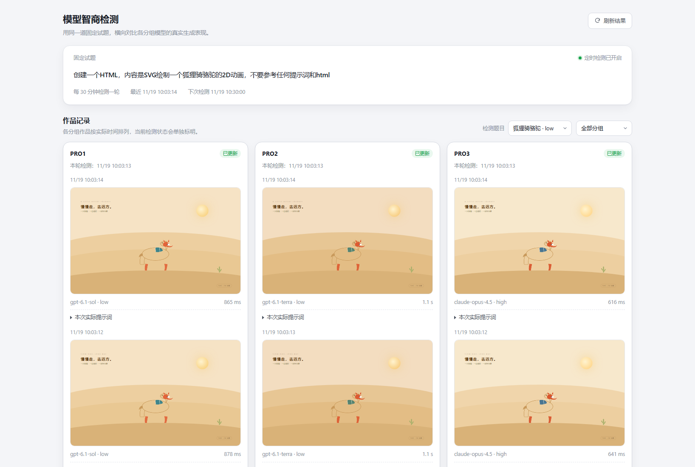
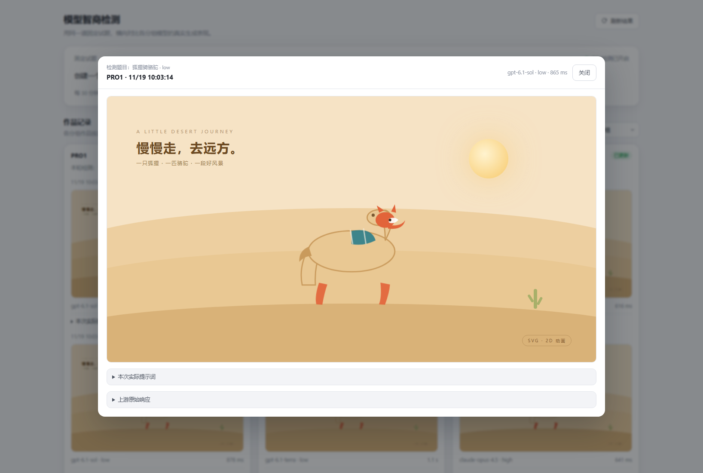
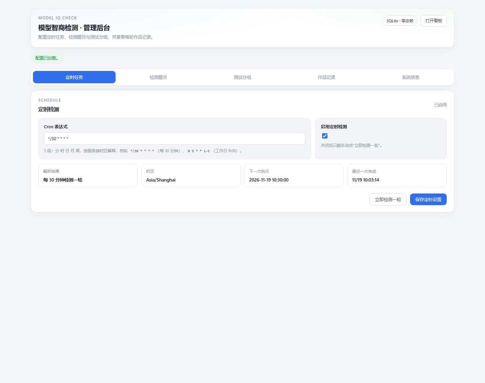
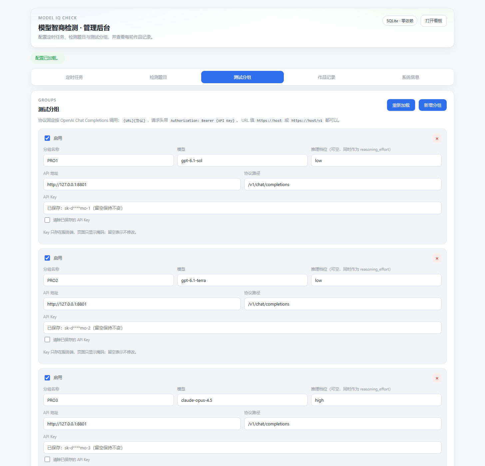
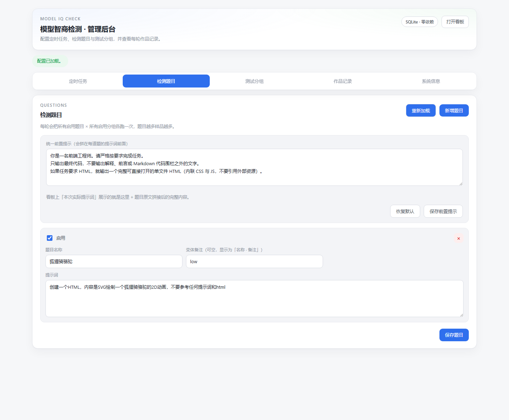
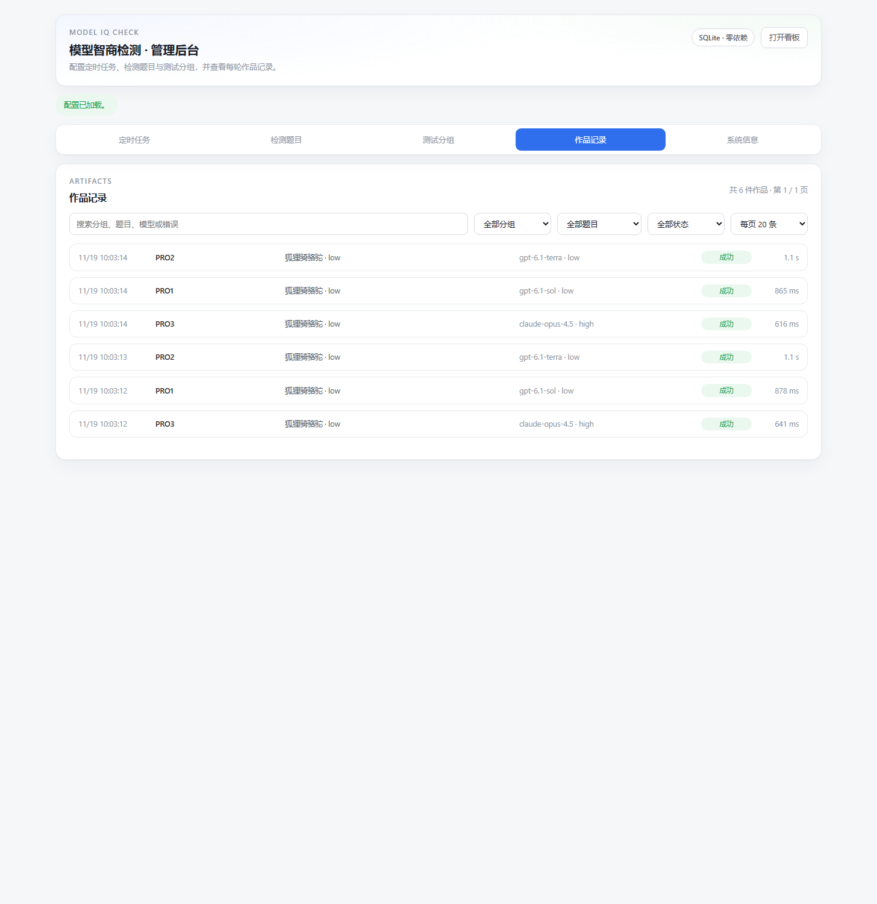
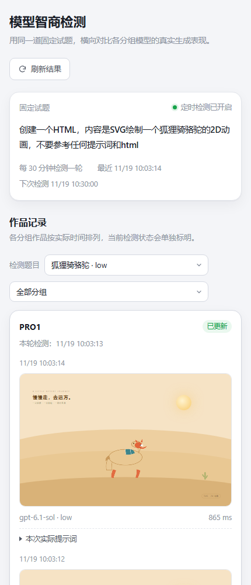

# sub2api-check

**模型智商检测**：用同一道固定试题，定时并发调用多组 OpenAI 兼容接口（Chat Completions 协议），把每个分组模型生成的 HTML 作品原样存档，并在看板上横向对比。

- 零 npm 依赖，单进程 Node.js 服务，数据存 SQLite（`node:sqlite`）
- 定时任务用标准 5 段 Cron（按服务端时区解释），也可手动「立即检测一轮」
- 后台可视化维护：Cron、检测题目（可多道）、测试分组（URL / API Key / 模型 / 协议）、统一前置提示
- 作品记录：看板按分组分列展示 + 分页；后台可搜索、筛选、分页、删除
- 作品用沙箱 iframe 实时渲染，服务端只存 HTML 文本，不需要无头浏览器
- 分组 API Key 只保存在服务端，接口只回显掩码



作品放大预览：



管理后台：









移动端：



## 功能

- **固定试题对比**：同一道题在不同分组上跑，生成结果并排展示，直接看谁画得好。
- **Cron 定时**：`*/30 * * * *` 每 30 分钟一轮，支持每天固定时刻、工作日、每月某日等写法。
- **多题目 × 多分组**：每轮把所有启用题目 × 所有启用分组各跑一次，互不干扰。
- **作品存档**：保存完整 HTML、实际提示词、上游原始响应、耗时、成功/失败原因。
- **状态可见**：看板每个分组显示本轮状态（已更新 / 检测中 / 无新作品 / 本轮失败），没有新作品时保留上次作品。
- **分页**：看板按分组分列分页，后台作品记录支持按题目 / 分组 / 状态 / 关键词筛选 + 分页。
- **安全隔离**：作品以 `sandbox="allow-scripts"` iframe 加载，并带 `Content-Security-Policy: sandbox allow-scripts`，作品无法读取本服务数据或 Cookie。
- **系统信息**：数据库路径、时区、超时、并发、作品总量、最近轮次明细。

## 快速开始

要求 Node.js **>= 22.5**（使用内置 `node:sqlite`，启动时的 SQLite ExperimentalWarning 属正常现象）。

```bash
cp .env.example .env
# 编辑 .env，至少改 CHECK_ADMIN_PASSWORD（想改端口/路径也在这里）
npm run start:env
```

或者直接用 Docker：

```bash
cp .env.example .env && mkdir -p data
docker compose pull && docker compose up -d     # 用 GHCR 远程镜像
# 或本地构建：docker compose -f docker-compose.yml -f docker-compose.build.yml up -d --build
```

打开：

- 看板：`http://127.0.0.1:8789/`
- 后台：`http://127.0.0.1:8789/admin/`（密码 `CHECK_ADMIN_PASSWORD`）
- 健康检查：`http://127.0.0.1:8789/healthz`

首次启动会写入：一道「狐狸骑骆驼」试题、三个占位分组（PRO1/PRO2/PRO3，URL 和 Key 为空）、Cron `*/30 * * * *`。**接下来必须去后台把分组的 URL / API Key / 模型补齐**，否则检测轮次会跳过这些分组。

想在本地先看效果（自带假上游和示例作品）：

```bash
npm run demo        # 看板 http://127.0.0.1:8799/ ，密码 demo-password
```

## 配置

所有配置通过环境变量提供，`.env.example` 有完整注释；Cron、题目、分组、前置提示首次启动写入 SQLite 后，以管理后台为准。

| 变量 | 默认值 | 说明 |
| --- | --- | --- |
| `PORT` | `8789` | 监听端口 |
| `PUBLIC_BASE_PATH` | `/` | 对外路径前缀，反代到 `/check/` 时填 `/check` |
| `CHECK_DB_FILE` | `./data/check.db` | SQLite 文件，相对项目根目录 |
| `CHECK_TIMEZONE` | `Asia/Shanghai` | Cron 与时间展示使用的时区 |
| `CHECK_ADMIN_PASSWORD` | 空 | 后台密码；为空时后台接口全部禁用（看板仍可读） |
| `CHECK_TITLE` / `CHECK_SUBTITLE` | `模型智商检测` / … | 看板标题与副标题 |
| `CHECK_CRON` | `*/30 * * * *` | 首次启动写入的 Cron |
| `CHECK_CRON_ENABLED` | `true` | 首次启动是否启用定时 |
| `CHECK_REQUEST_TIMEOUT_SECONDS` | `180` | 单次模型调用超时 |
| `CHECK_MAX_OUTPUT_CHARS` | `200000` | 单份作品最大保存字符数（超出截断） |
| `CHECK_SEND_REASONING_EFFORT` | `true` | 是否把分组的 low/medium/high 作为 `reasoning_effort` 发给上游 |
| `CHECK_CONCURRENCY` | `3` | 一轮内的并发请求数（1-8） |
| `CHECK_DISABLE_SCHEDULER` | `false` | 设为 true 只用手动触发（测试用） |
| `CHECK_LOG_FILE` | 空 | 可选：额外把单行 JSON 日志追加写入文件 |

## 一轮检测做了什么

1. 读取所有**启用**的题目和分组；缺 URL / API Key / 模型的分组自动跳过，并在轮次备注里说明。
2. 写入一条 `rounds` 记录（`trigger=cron|manual`，状态 `running`）。
3. 对每个「分组 × 题目」组合并发调用上游（并发数 `CHECK_CONCURRENCY`）：
   - 实际提示词 = 统一前置提示 + `— 试题 —` + 题目原文
   - 请求：`POST {URL}{协议}`，头 `Authorization: Bearer {API Key}`，体 `{model, messages:[{role:"user",content}], stream:false}`，`reasoning_effort` 仅在分组填了档位时附带
4. 从响应里取 `choices[0].message.content`，去掉 Markdown 围栏和开场白，补成完整 HTML（或按纯文本存档）。
5. 写入一条 `artifacts` 记录（状态、耗时、提示词、HTML、原始响应、错误信息）。
6. 收尾更新轮次状态：`done` / `partial` / `error`，并计算下一次执行时间。

看板上「本轮检测」时间是本轮开始时间；如果某分组在这一轮没有产出（跳过或失败），卡片会显示「本轮作品暂未展示/生成失败，保留上次作品」，并继续展示历史作品。

## Cron 写法

标准 5 段：`分 时 日 月 周`，按 `CHECK_TIMEZONE` 解释，支持 `*`、`a-b`、`*/n`、`a-b/n`、`a,b`、月份/星期英文缩写，以及 `@hourly` `@daily` `@weekly` `@monthly` `@yearly`。

| 表达式 | 含义 |
| --- | --- |
| `*/30 * * * *` | 每 30 分钟 |
| `0 * * * *` | 每小时整点 |
| `0 9 * * *` | 每天 09:00 |
| `0 9 * * 1-5` | 工作日 09:00 |
| `30 8 1 * *` | 每月 1 日 08:30 |
| `0 0 13 * 5` | 每月 13 日**或**每周五 00:00（日与周同时限制时取并集） |

后台「定时任务」页输入表达式后会实时显示中文解析结果和下一次执行时间，保存前可以先确认。表达式非法会直接返回 400，不会写入。

## 上游协议

只按 OpenAI **Chat Completions** 协议调用，分组里可以分别配置：

- **API 地址**：`https://api.example.com` 或 `https://api.example.com/v1` 都行（自动避免拼出 `/v1/v1`）
- **协议路径**：默认 `/v1/chat/completions`，也可以填完整 URL
- **API Key**：以 `Authorization: Bearer …` 发送，只存在服务端
- **模型** / **推理档位**：档位填 `low`/`medium`/`high` 时会同时作为 `reasoning_effort` 发送，只用于展示也可以随便填

上游返回非 2xx、超时、没有正文时，这一格记为失败并保存错误摘要（后台可看完整原始响应）。

## 安全说明

- **作品隔离**：作品 HTML 通过 `/api/artifact/{id}/html` 返回，响应头带 `Content-Security-Policy: sandbox allow-scripts`，前端 iframe 再叠一层 `sandbox="allow-scripts"`（不含 `allow-same-origin`）。作品脚本可以跑动画，但拿不到本服务的 Cookie、localStorage 和同源接口。
- **看板是公开只读的**：不含任何密钥字段，只暴露分组名、模型、作品与耗时。若不希望公网可见，请在反向代理层加访问控制。
- **API Key 不回显**：后台接口只返回 `sk-a****z9` 形式的掩码，保存时空着表示不修改，勾选「清除已保存的 API Key」才会删除。
- 只有管理密码能触发检测（会消耗你的上游额度），看板的「刷新结果」只重新读取数据，不会发起新请求。

## API

所有接口都在 `PUBLIC_BASE_PATH` 下。

| 方法 | 路径 | 鉴权 | 说明 |
| --- | --- | --- | --- |
| GET | `/healthz` | 无 | 健康检查 |
| GET | `/api/board?questionId=&groupId=&page=&pageSize=` | 无 | 看板数据（分组、题目、轮次状态、分列作品、分页信息） |
| GET | `/api/artifact/{id}` | 无 | 作品详情（实际提示词、原始响应、耗时） |
| GET | `/api/artifact/{id}/html` | 无 | 作品正文（`text/html` 或 `text/plain`，带 CSP sandbox） |
| GET | `/api/admin/session` | 管理密码 | 校验密码 |
| GET | `/api/admin/config` | 管理密码 | 全部配置 + 统计 + 最近轮次 + 系统信息 |
| PUT | `/api/admin/schedule` | 管理密码 | 保存 `{cron, enabled}`，立即重排下一次执行 |
| PUT | `/api/admin/questions` | 管理密码 | 整组替换题目 `{questions:[…]}` |
| PUT | `/api/admin/groups` | 管理密码 | 整组替换分组 `{groups:[…]}`（`apiKey` 省略 = 保持不变） |
| PUT | `/api/admin/prompt` | 管理密码 | 保存统一前置提示 `{systemPrompt}` |
| POST | `/api/admin/run` | 管理密码 | 立即检测一轮（异步启动，立即返回） |
| GET | `/api/admin/records?page=&pageSize=&q=&groupId=&questionId=&status=` | 管理密码 | 作品记录分页查询 |
| GET | `/api/admin/artifacts/{id}` | 管理密码 | 作品完整详情（含原始响应） |
| DELETE | `/api/admin/artifacts/{id}` | 管理密码 | 删除作品 |
| GET | `/api/admin/cron-preview?cron=` | 管理密码 | Cron 解析预览 |

管理密码请求头：`X-Check-Admin-Password`，也兼容 `Authorization: Bearer <password>` 和 Basic Auth。

## 部署

推荐放在 Sub2API 同域名下的子路径（也能独立域名部署，看板本身不需要 Sub2API 登录态）：

```caddyfile
ai.example.com {
  handle /check/* {
    reverse_proxy 127.0.0.1:8789
  }

  handle {
    reverse_proxy 127.0.0.1:3000
  }
}
```

Nginx：

```nginx
location /check/ {
    proxy_pass http://127.0.0.1:8789;
    proxy_http_version 1.1;
    proxy_set_header Host $host;
    proxy_set_header X-Real-IP $remote_addr;
    proxy_set_header X-Forwarded-Proto $scheme;
}
```

注意：

- 保留 `/check` 前缀时 `.env` 里要写 `PUBLIC_BASE_PATH=/check`；如果用 `handle_path` 去掉前缀，就写 `/`。
- 数据在 `./data/check.db`，升级容器时继续挂载 `./data:/app/data` 即可保留历史作品。
- 单实例部署：定时器在进程内，多副本会重复跑检测。要多实例请自行改成外部调度（用 `POST /api/admin/run`）。

## 开发

```bash
npm run check     # 语法检查
npm run test      # node:test：Cron 单测 + 端到端接口测试（自带假上游）
npm run dev       # node --watch
npm run demo      # 本地演示环境（假上游 + 两轮示例作品）
npm run ui-check  # 用本机 Edge/Chrome 无头截图到 picture/，并收集前端 console 错误
```

项目结构：

```text
src/
  server.js    HTTP 路由、看板/后台聚合、校验
  runner.js    轮次执行、并发调度、Cron 定时器
  upstream.js  Chat Completions 调用与错误归一
  artifact.js  从模型输出抽取 HTML / 纯文本作品
  store.js     SQLite 数据访问（settings/questions/test_groups/rounds/artifacts）
  cron.js      Cron 解析、下一次执行时间、中文解释
  config.js    环境变量与默认值
  time.js      时区格式化
  pages.js     看板/后台 HTML
  http.js      JSON/HTML/静态文件工具
  log.js       单行 JSON 日志
public/
  app.js       看板：分列作品、缩放预览、分页、弹窗
  admin.js     后台：定时/题目/分组/前置提示/记录
  styles.css   看板样式
  admin.css    后台样式
scripts/
  demo.mjs     本地演示（假上游 + 示例作品）
  ui-check.mjs 无头截图 + 前端错误检查
tests/
  cron.test.js Cron 单测
  api.test.js  端到端接口与执行链路测试
```

## 数据维护

```bash
# 备份（先停服务，WAL 一起复制更稳）
docker compose stop sub2api-check
cp data/check.db data/check.db.bak
docker compose start sub2api-check
```

作品会随轮次持续增长，单份上限由 `CHECK_MAX_OUTPUT_CHARS` 控制；不需要的历史可以在后台「作品记录」里逐条删除，或直接清空 `artifacts` 表。

## 常见问题

**看板某些分组一直显示「本轮作品暂未展示」**

该分组没有 URL / API Key / 模型，或在后台被停用了。检测轮次的备注会列出被跳过的分组，后台「系统信息 → 最近轮次」里能看到。

**本轮失败，错误在哪看**

看板卡片会显示错误摘要；后台「作品记录」可以展开看完整错误，`GET /api/admin/artifacts/{id}` 里也有上游原始响应。

**改了分组保存后 Key 没了**

保存时 Key 输入框留空表示「保持不变」；只有勾选「清除已保存的 API Key」才会清空。

**定时没触发**

看后台「定时任务」里的「下一次执行」是否有值：为空说明表达式没匹配（例如 `0 0 30 2 *`），或者被停用了。也检查 `CHECK_DISABLE_SCHEDULER` 是否为 true。

**作品里的动画不动**

作品是模型生成的 HTML，动画由它自己实现；如果它只画了静态 SVG，就不会动。点开预览可以确认原始效果。
